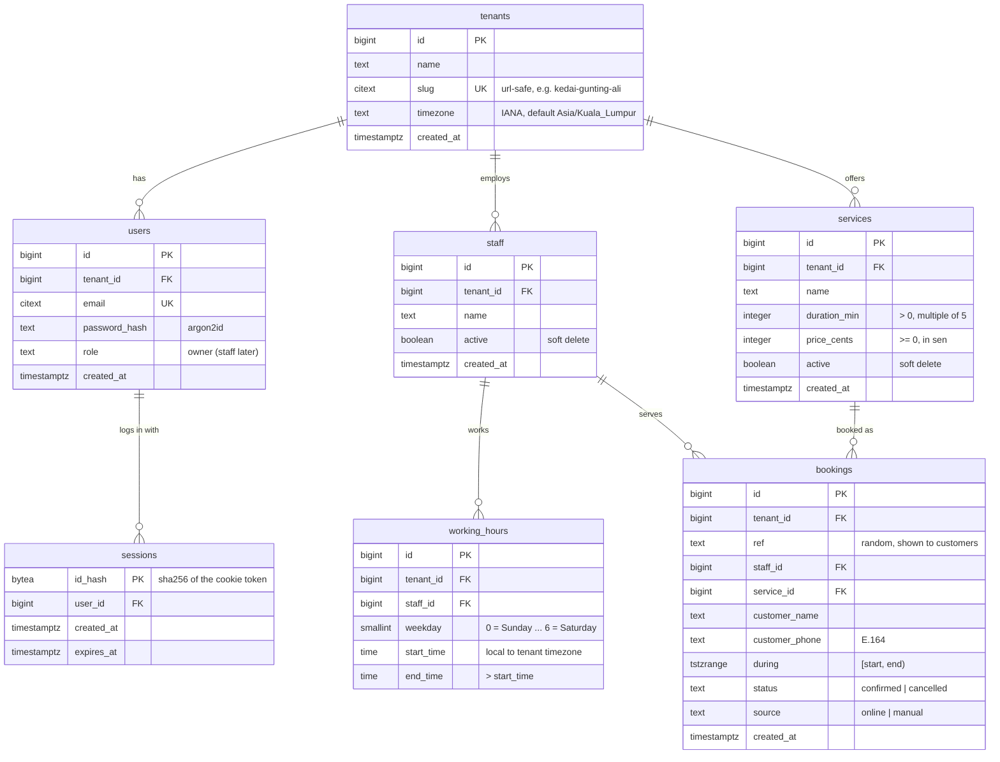

# Tempah: Data Model

| | |
| --- | --- |
| **Status** | Draft |
| **Last updated** | 2026-10-23 |
| **Related** | [PRD](prd.md) · [API contract](api.md) · [ADR-0002](adr/0002-exclusion-constraint-for-double-booking.md) · [ADR-0003](adr/0003-row-level-security-for-tenancy.md) · [ADR-0007](adr/0007-bigint-ids-and-public-refs.md) |

Every business table carries a `tenant_id`, which Row-Level Security filters on ([ADR-0003](adr/0003-row-level-security-for-tenancy.md)). `tenants`, `users` and `sessions` are global tables without RLS, because they're read before the tenant is known.

## Diagram (MVP)



## What changes from the current repo

`users` and `sessions` came from the original auth code and now live in the first migration. Registering a business (Day 8) brings these changes:

| Table | Change | Why |
| --- | --- | --- |
| `users` | Add `tenant_id BIGINT NOT NULL REFERENCES tenants` | Every owner belongs to one business |
| `users` | Add `role TEXT NOT NULL DEFAULT 'owner'` | Room for staff logins later |
| `users` | Drop `username` | The business `slug` is the public handle. Owners log in by email. |
| `sessions` | No change | Already matches [ADR-0004](adr/0004-server-side-sessions.md) |

## Constraints that carry business rules

These rules live in the database, not only in application code. If the code has a bug, Postgres still refuses bad data.

| Table | Constraint | Why |
| --- | --- | --- |
| `tenants` | `UNIQUE (slug)` | One public URL per business |
| `tenants` | `CHECK (slug::text ~ '^[a-z0-9-]{3,40}$')` | URL-safe, lowercase slugs only. The cast to `text` makes the match case-sensitive. |
| `users` | `UNIQUE (email)` | Email is the login identity |
| `users` | `CHECK (role IN ('owner'))` | Widened when staff logins arrive |
| `services` | `CHECK (duration_min > 0 AND duration_min % 5 = 0)` | No zero-length or odd-length services |
| `services` | `CHECK (price_cents >= 0)` | Money stored as integer sen, never floats |
| `working_hours` | `CHECK (weekday BETWEEN 0 AND 6)` | Matches JavaScript's `Date.getDay()` |
| `working_hours` | `CHECK (end_time > start_time)` | No overnight shifts in the MVP |
| `working_hours` | `EXCLUDE USING gist (staff_id WITH =, weekday WITH =, tsrange(...) WITH &&)` | One staff member's ranges on the same day can't overlap. Back-to-back is fine. |
| `bookings` | `UNIQUE (tenant_id, ref)` | A customer's reference finds exactly one booking |
| `bookings` | `CHECK (status IN ('confirmed', 'cancelled'))` | `pending` is added in Phase 7 |
| `bookings` | `CHECK (source IN ('online', 'manual'))` | Who created the booking: the customer or the owner |
| `bookings` | `CHECK (NOT isempty(during))` | A booking always has a length |
| `bookings` | `EXCLUDE USING gist (staff_id WITH =, during WITH &&) WHERE (status <> 'cancelled')` | **No overlapping bookings for one staff member.** See [ADR-0002](adr/0002-exclusion-constraint-for-double-booking.md). |

### Same-tenant foreign keys

A plain `staff_id REFERENCES staff(id)` would allow a booking in tenant A to point at a staff member in tenant B. To make that impossible, child tables reference the parent by **both** columns:

```sql
-- on staff and services:
UNIQUE (tenant_id, id)

-- on bookings:
FOREIGN KEY (tenant_id, staff_id)   REFERENCES staff (tenant_id, id),
FOREIGN KEY (tenant_id, service_id) REFERENCES services (tenant_id, id)

-- on working_hours:
FOREIGN KEY (tenant_id, staff_id)   REFERENCES staff (tenant_id, id) ON DELETE CASCADE
```

Bookings use the default `ON DELETE NO ACTION`, so a staff member or service with bookings cannot be hard-deleted. The API soft-deletes them (`active = false`) instead.

## Extensions

Created in the first migration. Both are *trusted* extensions, so the database owner can create them without superuser rights.

| Extension | Used for |
| --- | --- |
| `citext` | Case-insensitive `email` and `slug` (already in the repo) |
| `btree_gist` | Lets the exclusion constraint combine `staff_id WITH =` (a plain equality) with a range overlap |

## Indexes

| Index | Serves |
| --- | --- |
| GiST index created by the exclusion constraint on `(staff_id, during)` | Overlap checks and the availability query |
| `bookings (tenant_id, lower(during))` | Owner dashboard: "bookings for this date" |
| `working_hours (tenant_id, staff_id, weekday)` | Availability query |
| `staff (tenant_id)`, `services (tenant_id)` | Owner list pages |
| `sessions (user_id)`, `sessions (expires_at)` | Logout everywhere, expired-session cleanup (already in the repo) |

## Naming conventions

- Tables are plural `snake_case`, columns `snake_case`. The API layer converts to `camelCase`.
- Primary keys are `id BIGINT GENERATED ALWAYS AS IDENTITY`, sent as strings in JSON ([ADR-0007](adr/0007-bigint-ids-and-public-refs.md)).
- Every table gets `created_at timestamptz NOT NULL DEFAULT now()`. Add `updated_at` only where something edits rows.
- Timestamps are always `timestamptz`, never `timestamp`. Local wall-clock times (`working_hours.start_time`) are `time`, interpreted in the tenant's timezone.

## Added later (Phase 7)

| Table or change | Purpose |
| --- | --- |
| `bookings.status` gains `pending`, plus `expires_at timestamptz` | Hold a slot while the customer pays a deposit |
| `processed_events (provider, event_id PK, processed_at)` | Make Stripe webhooks idempotent |
| `jobs (id, kind, payload jsonb, run_at, attempts, status, last_error)` | Postgres-backed job queue (`FOR UPDATE SKIP LOCKED`). Also takes over expired-session cleanup. |
| `booking_events (id, booking_id, type, actor, data jsonb, created_at)` | Append-only audit log of every booking change |
